# Network Traffic Analysis

**Windows Network Defense & Packet Analysis Lab**

   

## Objective

Investigate network activity in a Windows lab by identifying active connections and services, configuring firewall controls, and inspecting captured HTTP, TLS, DNS, and ICMP traffic. This repository documents the **complete original lab** with all **21 screenshots** in sequence.

## Skills Learned

- Identifying IP configuration, listening ports, and associated processes.
- Auditing and managing Windows services with PowerShell.
- Creating, modifying, and removing Windows Defender Firewall rules.
- Performing basic network reconnaissance with Nmap.
- Filtering and interpreting network packets in Wireshark.
- Distinguishing between unencrypted HTTP and encrypted TLS traffic.
- Understanding how DNS resolution and ICMP connectivity tests appear in network investigations.

## Tools Used

| Tool | Purpose |
| --- | --- |
| [Wireshark](https://www.wireshark.org/) | Packet capture, display filters, and protocol inspection |
| [Nmap](https://nmap.org/) | Host and service reconnaissance |
| [PowerShell](https://learn.microsoft.com/en-us/powershell/) | Network enumeration, service management, firewall configuration |
| [Windows Defender Firewall](https://learn.microsoft.com/en-us/windows/security/operating-system-security/network-security/windows-firewall/) | Inbound and outbound access-control rules |
| [Windows networking utilities](https://learn.microsoft.com/en-us/windows-server/administration/windows-commands/windows-commands) | `ipconfig`, `netstat`, `tasklist`, and `ping` |

## Lab Walkthrough

### 1. Establish a Network Baseline

*Ref 01 — IP configuration.* Used `ipconfig` to identify the Windows host's IPv4 address, subnet mask, and default gateway. This established which local interface and network to investigate.

### 2. Enumerate Connections and Processes

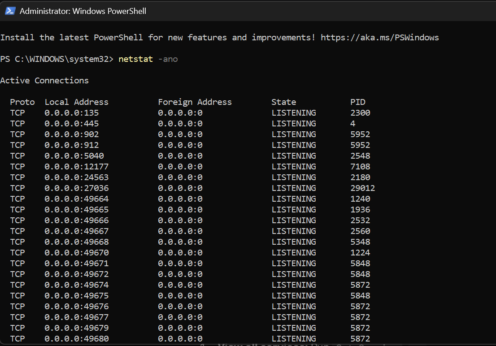

*Ref 02 — Active connections.* Ran `netstat -ano` to inspect listening ports, connection states, and process IDs (PIDs). This helps identify potential exposure from locally running services.

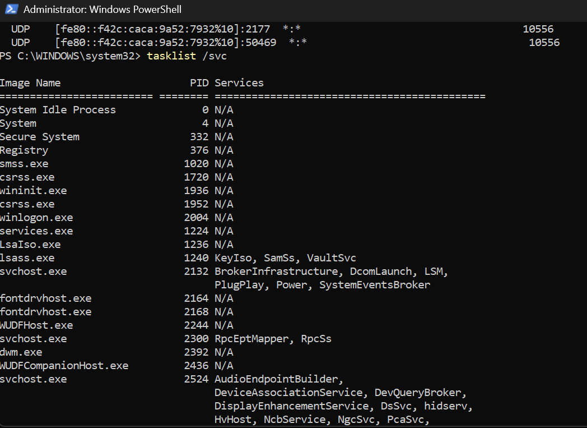

*Ref 03 — Process inventory.* Used `tasklist` to correlate process names with PIDs, providing context for connections discovered during port enumeration.

### 3. Audit and Manage Windows Services

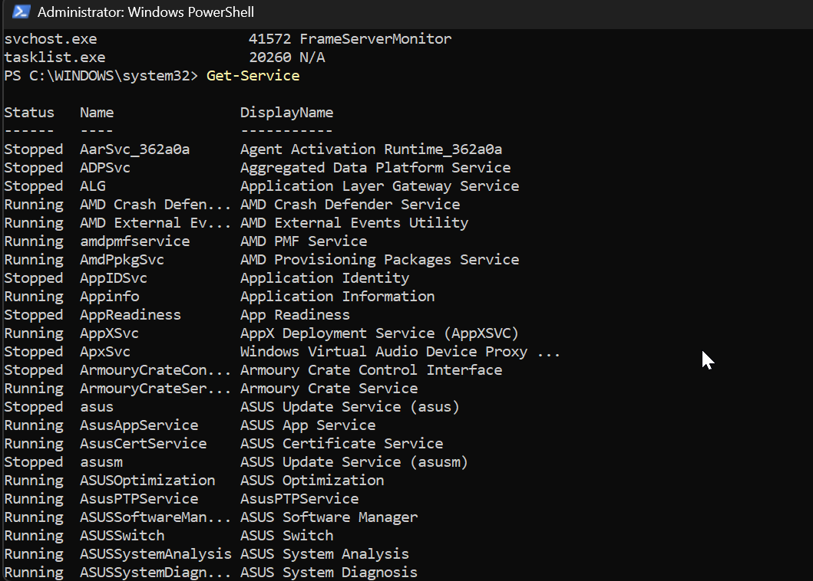

*Ref 04 — Service inventory.* Reviewed service names and running/stopped states with `Get-Service` to establish a service-management baseline.

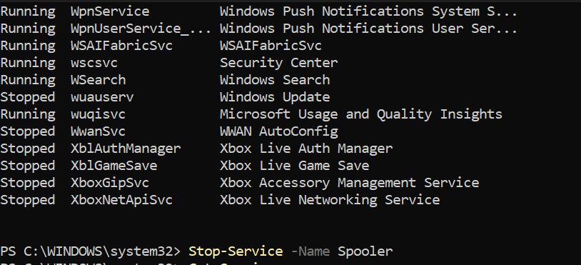

*Ref 05 — Controlled service change.* Located the Print Spooler service and issued `Stop-Service -Name Spooler` as a demonstration of service administration.

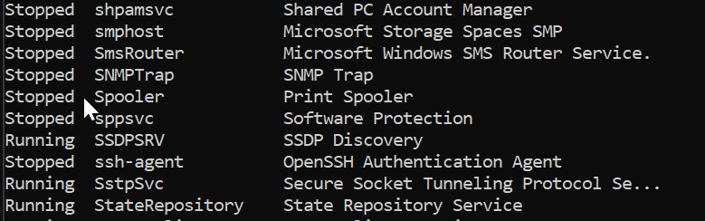

*Ref 06 — Stopped service.* Inspected service status after the stop command, illustrating how an administrator checks the effect of a change.

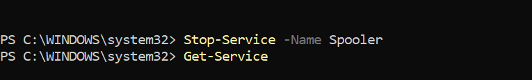

*Ref 07 — Service verification.* Repeated service-management and status queries in PowerShell to verify the controlled change rather than relying only on command execution.

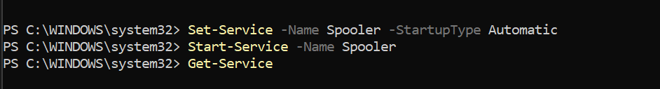

*Ref 08 — Service restoration.* Configured the Spooler startup type and issued a start command, demonstrating a return to the previous operational state.

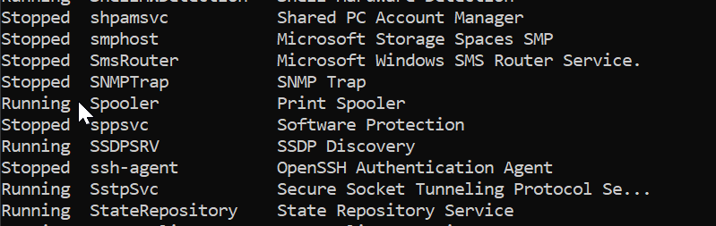

*Ref 09 — Restored status.* Verified that the service was running again, completing the stop–check–restore workflow.

### 4. Configure and Maintain Firewall Rules

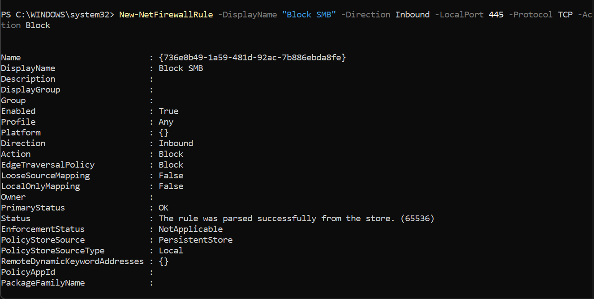

*Ref 10 — Inbound SMB control.* Created a Windows Defender Firewall rule to block inbound TCP port 445, a commonly exposed SMB service port.

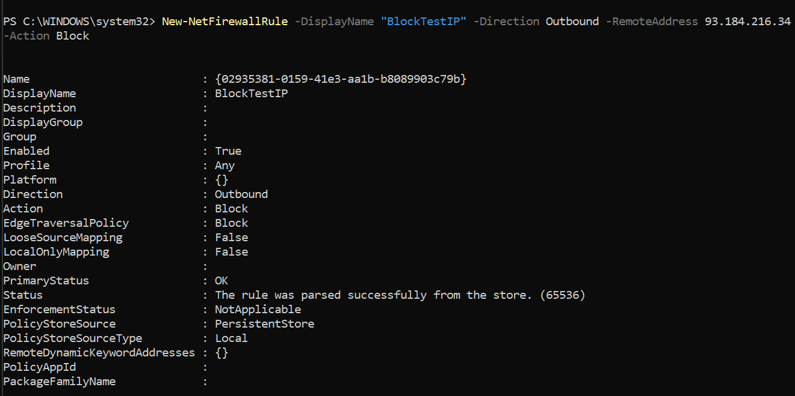

*Ref 11 — Outbound traffic control.* Created an outbound block rule for a specified test IP address, demonstrating host-based egress filtering.

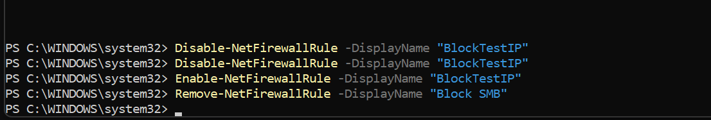

*Ref 12 — Rule lifecycle.* Practiced disabling, re-enabling, and removing firewall rules to demonstrate how security controls are maintained and reversed.

### 5. Perform Network Reconnaissance

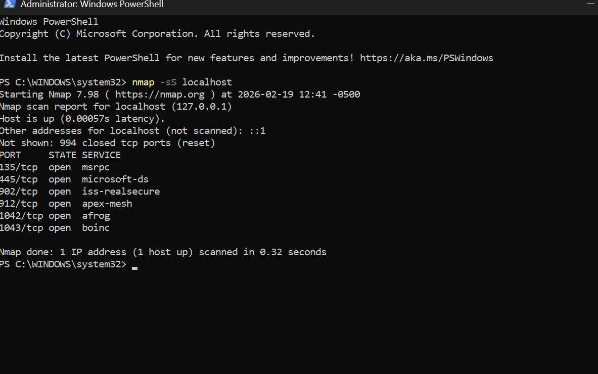

*Ref 13 — Nmap reconnaissance.* Ran an Nmap scan and examined the reported host/service information. Port-scan results provide a point of comparison with the local connection inventory.

### 6. Generate and Inspect Web Traffic

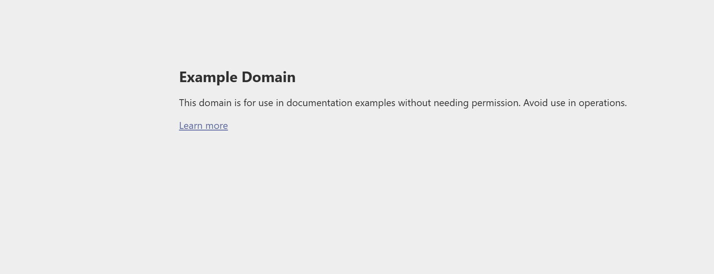

*Ref 14 — Browser-generated traffic.* Accessed a website to produce network activity for subsequent packet inspection.

*Ref 15 — HTTP analysis.* Applied an HTTP display filter in Wireshark and reviewed requests, responses, and protocol metadata to identify web exchanges.

*Ref 16 — TLS inspection.* Examined TLS handshake and application-data records. TLS packet metadata remains observable even though the encrypted payload is not readable in a normal capture.

*Ref 17 — DNS analysis.* Used the DNS filter to inspect name-resolution queries and responses, connecting domain lookups to the observed web traffic.

### 7. Investigate ICMP and Firewall Behavior

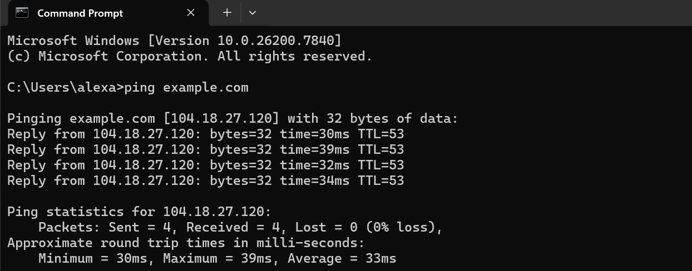

*Ref 18 — ICMP baseline.* Ran `ping` against a domain and reviewed replies, latency, and packet loss as a basic connectivity test.

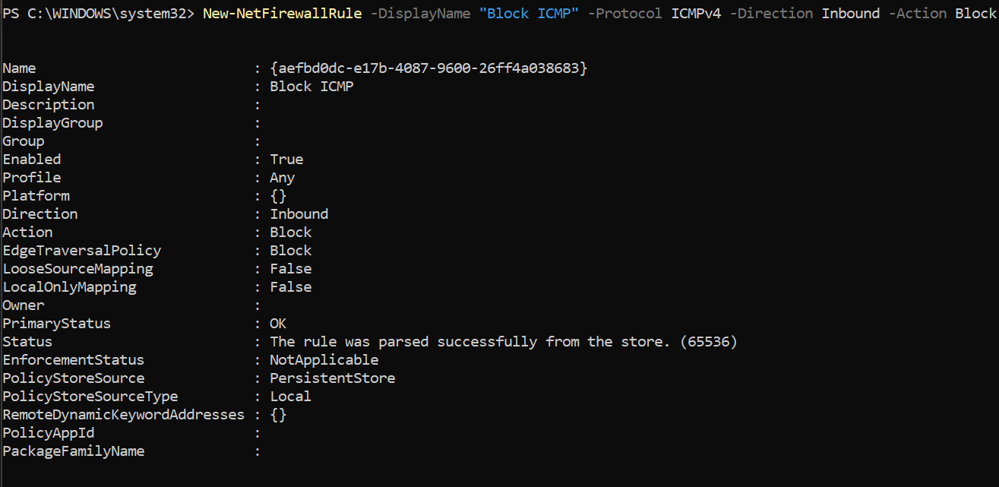

*Ref 19 — ICMP filtering rule.* Created an inbound ICMPv4 block rule. The screenshot documents successful rule creation, not a separate packet-drop validation.

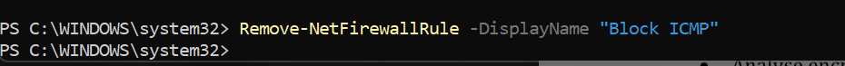

*Ref 20 — Cleanup.* Removed the temporary ICMP rule to restore the lab's prior configuration.

### 8. Review the Full Packet Capture

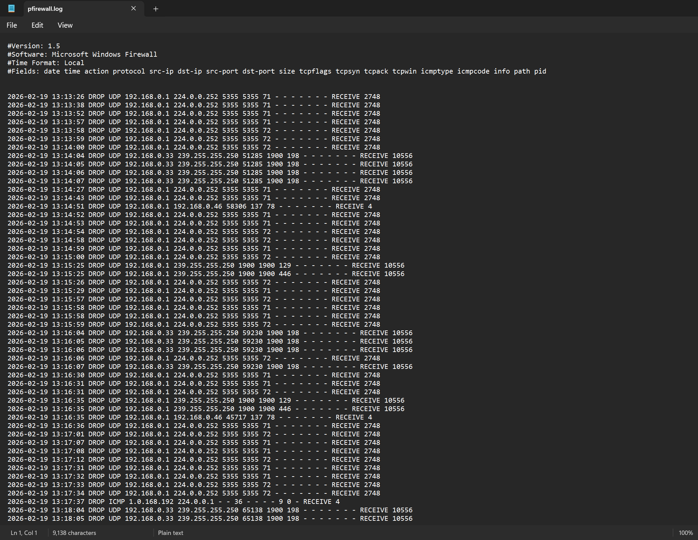

*Ref 21 — Capture overview.* Reviewed the broader list of captured packets and their timing, source/destination information, and protocols to place filtered HTTP, TLS, and DNS observations in context.

## Key Takeaways

- Host-level network visibility improves when ports, PIDs, services, and packet captures are examined together.
- Firewall rules should be documented and their lifecycle managed carefully, including test-rule removal.
- Wireshark display filters help isolate protocols, while the full capture provides additional investigative context.
- This was a **hands-on lab**; successful rule creation and protocol inspection should not be represented as enterprise-scale security validation.

## Evidence

All 21 screenshots are supplied in the [`screenshots/`](screenshots/) directory and linked above.

---

**Author:** [Alexander Cox](https://www.linkedin.com/in/alexandercox25/) · [GitHub Portfolio](https://github.com/KerberosAC)
