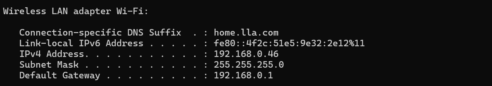
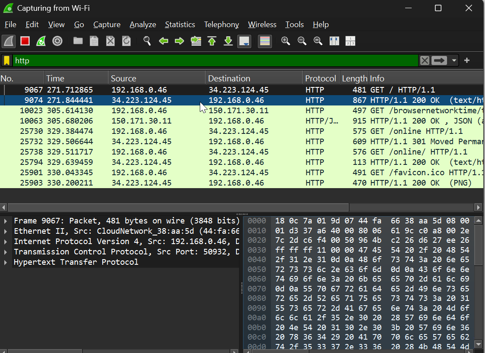
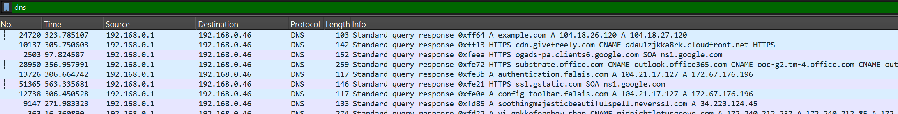

# Network Traffic Analysis | Wireshark Protocol Investigation


**Author:** Alexander Cox  
**Project type:** Network security lab  
**Focus:** Packet capture · Protocol inspection · Traffic filtering · Network troubleshooting

## Objective

Capture and examine network traffic with Wireshark to understand how common protocols appear on the wire. The exercise involved analyzing HTTP requests and responses, reviewing DNS resolution, recognizing TLS handshake records, and checking host connectivity in a controlled Windows lab environment.

## Skills Learned

- Capturing and filtering packets in Wireshark.
- Identifying HTTP request and response patterns.
- Examining DNS query responses and resolved IP addresses.
- Recognizing TLS handshake messages and encrypted sessions.
- Interpreting source and destination addresses in captured traffic.
- Using Windows networking commands to validate connectivity and local configuration.

## Tools Used

| Tool | Purpose |
| --- | --- |
| [Wireshark](https://www.wireshark.org/) | Packet capture, display filtering, and protocol inspection. |
| [Windows](https://www.microsoft.com/windows) | Lab workstation and network diagnostics. |
| [Command Prompt](https://learn.microsoft.com/en-us/windows-server/administration/windows-commands/windows-commands) | `ping` and `ipconfig` checks. |
| [TCP/IP](https://www.rfc-editor.org/rfc/rfc9293) | Transport-level connection interpretation. |

## Lab Overview

The source screenshots show packet captures taken from a Windows workstation using a Wi-Fi interface. The workstation address shown in the capture is `192.168.0.46`; `192.168.0.1` appears as the local DNS responder in the sampled DNS traffic.

This is a protocol-analysis and troubleshooting lab. The screenshots do **not** establish a malicious intrusion, credential theft, or a production security incident.

## Steps

### 1. Identify the Local Network Configuration

The lab began by recording the Windows workstation's network information so captured source and destination addresses could be interpreted correctly.

```powershell
ipconfig
```



*Figure 1: Windows IP configuration showing the workstation address and default gateway.*

### 2. Inspect HTTP Traffic

Wireshark was used to isolate HTTP traffic with the display filter:

```wireshark
http
```

The capture shows HTTP `GET` requests and server responses, including `200 OK` and `301 Moved Permanently`. Source and destination columns help distinguish outbound requests from inbound responses.



*Figure 2: Filtered HTTP traffic showing requests, response codes, source and destination IPs, and packet details.*

**Observation:** HTTP protocol data is visible for inspection when traffic is not protected by an additional encryption layer. A `200` response indicates success; `301` indicates a redirect.

### 3. Review TLS Handshake Activity

The lab screenshots also show TLS protocol records, including TLS 1.2 handshake messages and TLS 1.3 application-data records.


*Figure 3: Wireshark records showing TLS 1.2 and TLS 1.3 traffic associated with encrypted connections.*

**Observation:** TLS metadata and record types may be visible, while encrypted application contents cannot be read directly from the capture without appropriate keys and authorization.

### 4. Analyze DNS Responses

The DNS display filter was used to narrow the packet list:

```wireshark
dns
```

The capture includes DNS responses from `192.168.0.1` to `192.168.0.46`. One response associates `example.com` with IPv4 addresses, demonstrating how DNS supports communication by resolving names into network destinations.



*Figure 4: Wireshark DNS filter showing name-resolution responses and returned address records.*

**Observation:** DNS responses are useful for understanding the domains a host resolves and can support investigations when combined with timestamps and connection evidence. A DNS response alone does not prove that a website was visited.

### 5. Verify Connectivity with ICMP

Connectivity was checked from Windows using:

```powershell
ping example.com
```


*Figure 5: Successful ICMP echo replies with four packets received and no observed loss in this test.*

**Observation:** The test confirms connectivity at that moment, but does not establish that every application-layer service is available.

## Key Findings

| Protocol | Evidence in screenshots | Investigative value |
| --- | --- | --- |
| HTTP | GET requests, 200 and 301 responses | Understand request/response behavior and web destinations. |
| TLS | TLS 1.2 handshake messages and TLS 1.3 records | Recognize encrypted sessions and visible metadata. |
| DNS | DNS responses with domain names and addresses | Investigate name resolution and potential destination relationships. |
| ICMP | Successful ping replies | Validate basic reachability and latency. |

## Security Takeaways

- Protocol filters make packet captures easier to investigate without losing the broader traffic context.
- HTTP traffic may expose application details; encrypted HTTPS/TLS reduces visibility into payload contents.
- DNS analysis can provide leads, but meaningful conclusions require correlation with other network evidence.
- Proper interpretation of packet direction, timestamps, and response codes prevents incorrect conclusions.

## Conclusion

This exercise strengthened my practical network analysis skills by using Wireshark to interpret HTTP, TLS, and DNS traffic and Windows tools to verify connectivity. The project demonstrates packet-inspection fundamentals relevant to network troubleshooting, SOC monitoring, and incident investigation.

## Evidence & Source

The screenshots were extracted from my original **Lab 1 Network defense** document. The original lab also contains Windows service and firewall configuration exercises, which are outside this project's primary protocol-analysis focus.

---

**Alexander Cox** · [LinkedIn](https://www.linkedin.com/in/alexandercox25/) · [GitHub Portfolio](https://github.com/KerberosAC)
